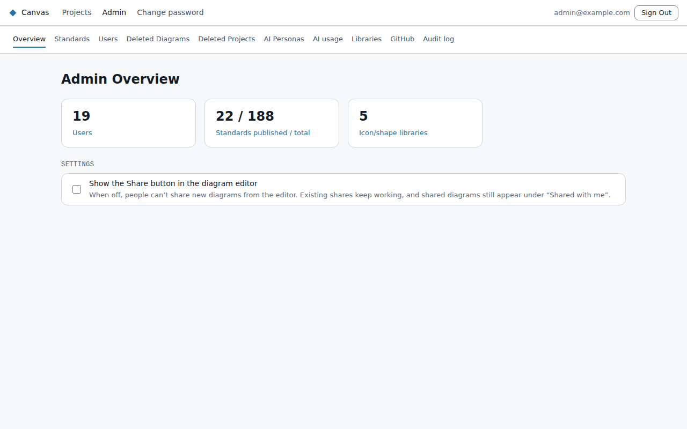

# Canvas admin guide

For people with the **admin** role. Admins see **Admin** in the top bar. It opens the admin console,
where the tabs along the top are its pages. Everything in the [user guide](../user-guide/README.md)
applies to you too.

| Page | What it's for | Guide |
|---|---|---|
| **Overview** | Counts of users, standards and icon libraries (the cards open their pages); **Settings**: show or hide the editor's **Share** button | [Settings](#settings) |
| **Users** | Add people, roles, passwords, unlock, two-step verification, deactivate, delete | [Managing people](people.md) |
| **Standards** | The rules diagrams are checked against, and the diagram types themselves | [Standards and diagram types](standards-and-diagram-types.md) |
| **Libraries** | The icon and shape libraries in the palette: import your own, retire, choose where they're offered | [Icon and shape libraries](libraries.md) |
| **AI Personas** | The AI assistants, their prompts and reference material; turning AI chat on or off | [AI](ai.md) |
| **AI usage** | Tokens (and estimated cost) by user; model prices | [AI](ai.md) |
| **Audit log** | Who signed in, failed, was locked, changed what | [Audit log and recovery](audit-and-recovery.md) |
| **Deleted Diagrams / Deleted Projects** | Restoring deleted work within 30 days | [Audit log and recovery](audit-and-recovery.md) |
| **GitHub** | Linking projects to GitHub repositories for diagram approval | [GitHub approval](github.md) |

Running Canvas itself (deploying, pausing, the IP allow-list, emergency access) is covered in
[Operations](operations.md).

## Settings

The **Settings** section of the Overview page has switches that apply to everyone:
- **Show the Share button in the diagram editor** (off by default). When it's off, nobody can share
  a diagram from the editor. Shares made earlier keep working, and shared diagrams still appear under
  **Shared with me**. Each change is recorded in the audit log.

## How people sign in

Canvas runs in one of two sign-in modes, chosen when it's deployed:
- **Microsoft Entra ID.** People sign in with their Microsoft work account. Their role comes from the
  Canvas app's roles in Entra, and two-step verification is your organisation's Entra policy.
  Accounts appear in Canvas on first sign-in.
- **Canvas accounts.** You create every account in Canvas. People sign in with email and password
  plus an authenticator code. In this mode the site is only reachable from your organisation's
  approved networks.

Some Users-page actions (passwords, unlock, two-step verification) only exist with Canvas accounts.
