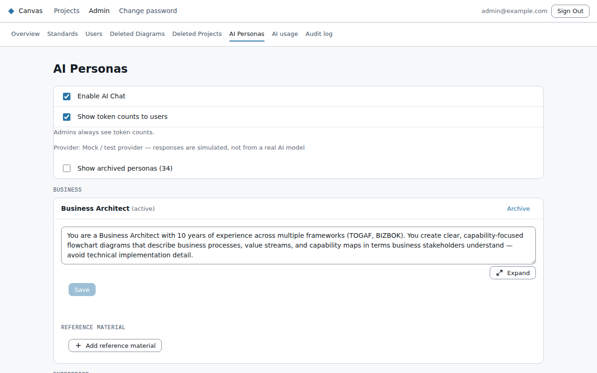
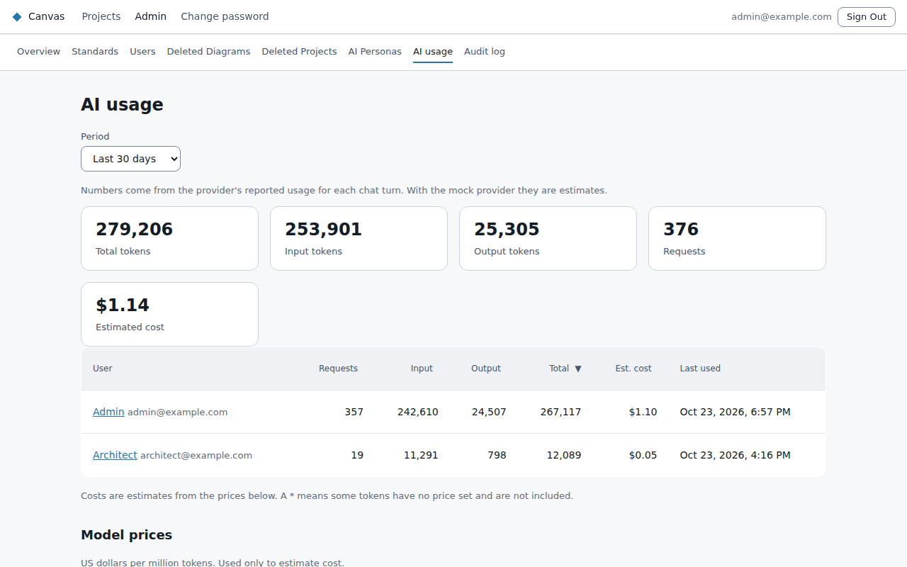
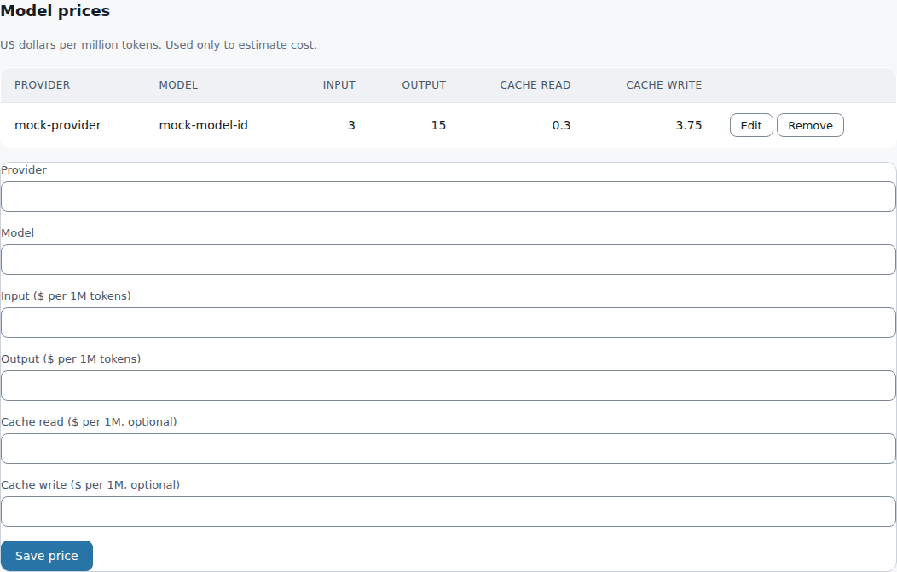

# AI

## Turning AI chat on or off

On **Admin → AI Personas**:
- **Enable AI Chat** turns AI chat and Create with AI on or off for everyone.
- **Show token counts to users** controls whether people who aren't admins see token counts in the
  chat panel and on their account page. Admins always see them.

## Personas

A **persona** is an AI assistant set up for one kind of work. Each has:
- a **name**;
- a **category** (Business, Enterprise, Solution or Technical);
- a **system prompt**: the instructions that shape how it behaves.

People pick a persona when they start a chat. Clicking into a prompt box enlarges it while you
work, and **Expand** opens a larger editor. **Archive** retires a persona without affecting past
conversations. **Show archived personas** lists them.

**Reference material:** knowledge the persona should draw on, such as your naming conventions or
your organisation's systems. Use **Add reference material**, and optionally limit an entry to
certain diagram types (none ticked means all). It's added to the AI's instructions for matching
diagrams.

## AI usage and cost

**Admin → AI usage** shows the tokens each person used over a period: the last 7 or 30 days, this
month, or a custom range. Click a person to see their use by day and by AI model.

**Estimated cost:** Canvas doesn't know your AI provider's prices. Enter them under **Model prices**
in US dollars per million tokens, for input, output and cached tokens. Canvas then estimates the cost
per person, per day and in total. Models without a price are flagged "no price set" and left out of
the cost, not counted as $0. Prices change, so treat the figures as estimates and check them against
your provider's bill. Only admins see cost.

