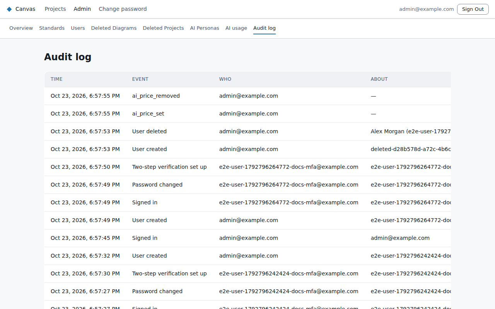
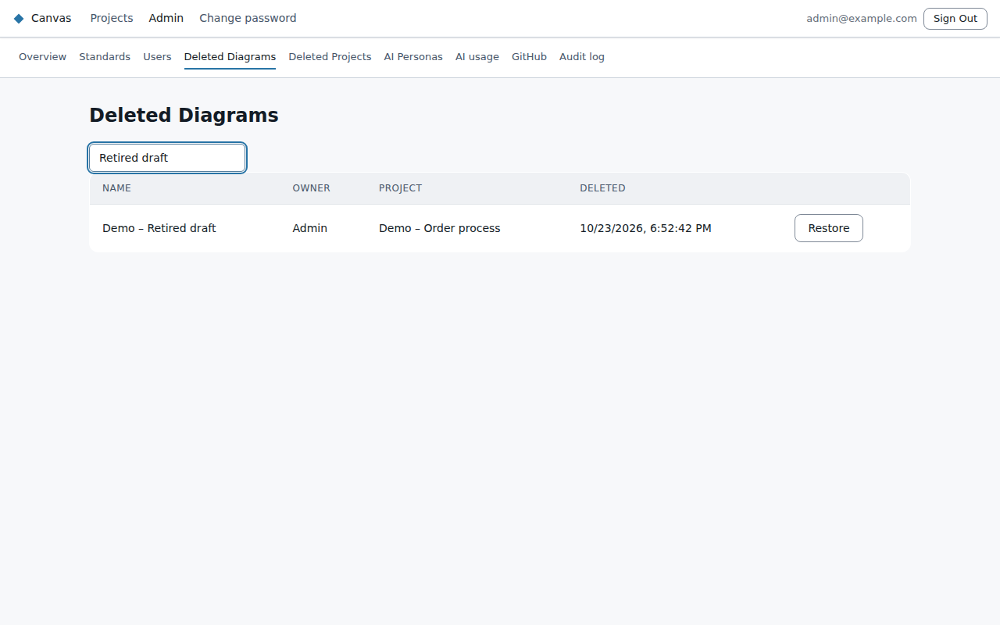

# Audit log and recovery

## The audit log

**Admin → Audit log** records, newest first:
- sign-ins, and failed sign-ins with the reason (wrong password, wrong code, locked, deactivated,
  unknown email);
- lockouts and unlocks;
- password changes and resets;
- two-step verification set-ups and resets;
- every change an admin makes to users: created, updated, deleted;
- changes to AI model prices;
- project membership: someone added to a project, their level changed or removed, and a project
  handed to a new owner.

Each entry shows **when**, **what**, **who did it**, **who it was about**, and from which **network
address**. Passwords and codes are never recorded. Use **View activity** on a person (Users page) to
see only their entries, and **Load older** to go further back.

## Restoring deleted work

Deleting a diagram or a project moves it to a bin for **30 days**:
- **Admin → Deleted Diagrams** and **Deleted Projects** list them.
- **Restore** brings one back. After 30 days it can no longer be restored.

A project can only be deleted once it has no diagrams.
