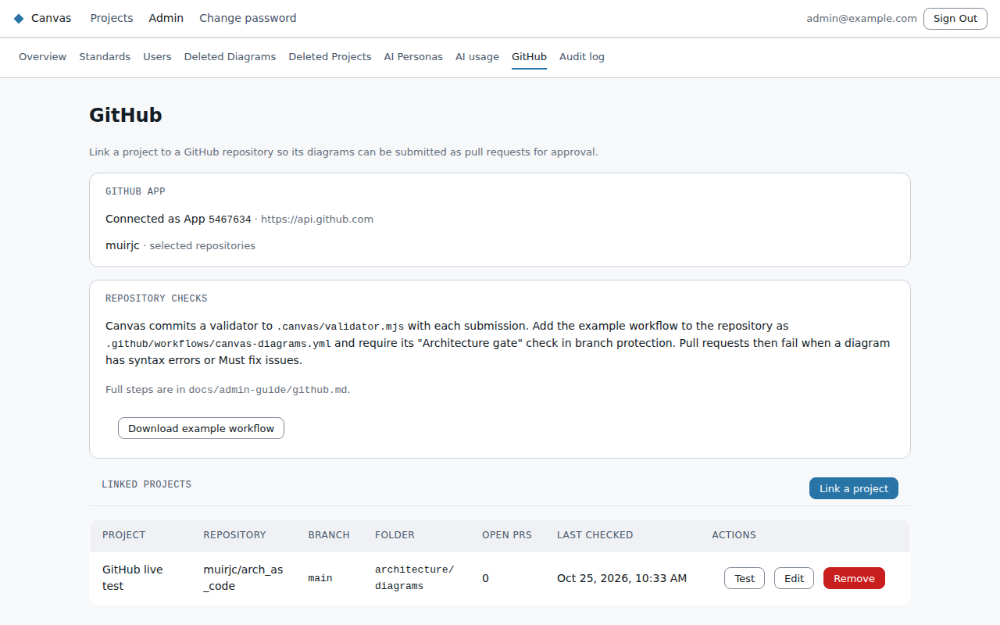

# GitHub approval

Canvas can send a diagram to a GitHub repository as a **pull request**. The repository's own
checks and reviewers then decide on it. Merging the pull request approves that version, and closing
it without merging rejects it. Canvas stays the place diagrams are edited, while GitHub becomes the
approval step and the long-term record.

Setting this up has three parts:
1. Create a GitHub App and install it on the repositories diagrams should go to. This is done once.
2. Give Canvas the App's id and private key when it's deployed. This is also done once.
3. Link each project to a repository and folder, on the **GitHub** admin page.

## 1. Create and install the GitHub App

In GitHub, go to your organisation's **Settings → Developer settings → GitHub Apps → New GitHub App**.

- **Name:** for example "Canvas diagrams". Commits and pull requests appear under this name.
- **Homepage URL:** your Canvas web address.
- **Webhook:** turn off **Active**. Canvas checks GitHub itself and never receives webhooks.
- **Repository permissions:**

  | Permission | Access |
  |---|---|
  | Contents | Read and write |
  | Pull requests | Read and write |
  | Checks | Read-only |
  | Commit statuses | Read-only |
  | Metadata | Read-only (always on) |

  Leave everything else at **No access**. Canvas never needs **Workflows** permission, and it never
  writes to `.github/`.
- **Where can this GitHub App be installed?** Only on this account.

Once the App is created:
- Note the **App ID** shown at the top of its settings page.
- Under **Private keys**, choose **Generate a private key** and keep the downloaded `.pem` file safe.
- Choose **Install App** and install it on **Only select repositories**, picking the repositories
  that diagrams should go to. You can add more repositories later.

**If your organisation uses an IP allow list** (**Settings → Authentication security**), GitHub
refuses Canvas's requests unless Canvas's outgoing address is on the list. You can either turn on
**Allow access by GitHub Apps** for installed apps, or add Canvas's static outgoing IP address.

## 2. Give Canvas the App's details

When Canvas is deployed to Azure, pass the App id and the key file to `infra/azure/deploy.sh` once:

```bash
CANVAS_GITHUB_APP_ID=123456 CANVAS_GITHUB_APP_PRIVATE_KEY_FILE=~/Downloads/canvas-diagrams.pem \
  ./deploy.sh --yes
```

The script keeps both values in `infra/azure/.secrets/` and stores the key in Key Vault as
`github-app-private-key`, so later deploys don't need them again.

For any other way of running Canvas, set these environment variables on the API:

| Variable | Value |
|---|---|
| `GITHUB_APP_ID` | The App ID |
| `GITHUB_APP_PRIVATE_KEY` | The `.pem` file's contents, or the contents base64-encoded on one line |
| `GITHUB_APP_API_URL` | Optional. Defaults to `https://api.github.com` |
| `CANVAS_PUBLIC_URL` | Optional. The web address used for links back to Canvas. Defaults to the first `WEB_ORIGINS` entry |

If the variables are missing, or set to `unset`, the integration is off and nobody sees it.

## 3. Link projects

Open **Admin → GitHub**. The top of the page shows whether the App is configured and where it's
installed. To link a project:
1. Choose **Link a project**.
2. Pick the project and a repository. Only repositories the App is installed on are listed.
3. Pick the branch the pull requests should target. It defaults to the repository's default branch.
4. Choose a folder, for example `architecture/diagrams`. Each diagram gets its own subfolder in it.



Each project needs its own link, because a project doesn't inherit one. Several projects can share a
repository, but each one needs its own folder, and one project's folder can't sit inside another's.

**Test** checks that the link still works: the App is installed, the repository is reachable, the
branch exists, and the permissions are granted. Run it after changing the App or the repository.
A link that stops working while pull requests are open, for example because the App was removed from the repository, shows
**Needs attention** on the GitHub page.

Removing a link stops new submissions. Pull requests that are already open stay open, and Canvas
keeps tracking them; the page shows how many there are. A diagram moved to a different project
while its pull request is open can't be submitted again until that pull request is merged, closed
or withdrawn.

## Keeping status up to date

GitHub can't send Canvas notifications, because Canvas only accepts traffic from your approved
networks. Canvas checks GitHub instead:
- every minute or so for a diagram that's open in the editor with a pull request in review;
- every 15 minutes for all open pull requests, run by the `canvas-github-sync` job in Azure. The
  job is created when a GitHub App is configured. `pause.sh` stops its schedule and `resume.sh`
  restores it.

To run the check by hand, start the job with
`az containerapp job start --name canvas-github-sync --resource-group canvas-rg`, or run
`npm run github-sync --workspace=@canvas/api` anywhere the API's settings are available.

## What a pull request contains

```
<folder>/<diagram-name>/README.md          the rendered diagram first, then its details
<folder>/<diagram-name>/<diagram-name>.svg the rendered diagram
<folder>/<diagram-name>/<diagram-name>.mmd plain Mermaid, readable by any Mermaid tool
<folder>/<diagram-name>/<diagram-name>.canvas.mmd  Canvas's own copy (positions, styles), exact
<folder>/<diagram-name>/canvas.json        a manifest for CI checks
.canvas/standards/<type>/v<n>.json         the standard the diagram was checked against
.canvas/validator.mjs                      the validator the repository's CI runs
```

Commits are made by the App, with a `Co-authored-by:` line naming the Canvas user who submitted.
A diagram keeps the folder it was first submitted to, even if it's renamed later. Canvas never
deletes or moves files in the repository.

## Checking diagrams in the repository's CI

With each submission, Canvas commits a small validator to `.canvas/validator.mjs` in the
repository. It is one file with no dependencies, and Canvas updates it whenever Canvas is updated.
A GitHub Actions workflow runs it on every pull request. For each diagram the validator:
- parses Canvas's copy of the diagram;
- checks it against the standard Canvas committed alongside it;
- marks problems on the pull request's files;
- attaches the rendered diagrams to the run for reviewers.

The check fails when a diagram has a syntax error or a Must fix issue. Warnings are shown but don't
fail it. Canvas already refuses to submit a diagram with Must fix issues, so a failing check usually
means someone edited the files in GitHub.

To set it up:
1. On **Admin → GitHub**, choose **Download example workflow**.
2. Commit the file to the repository as `.github/workflows/canvas-diagrams.yml`. Canvas never writes
   workflows itself.
3. In the branch protection for the target branch, require the **Architecture gate** check. The
   workflow ends with this single check, so jobs can be added to it later without changing the
   protection rule.

Don't add `paths:` filters to the workflow. A required check that a path filter skips never reports,
and the pull request then waits forever.

You can also run the validator yourself in a clone of the repository:
`node .canvas/validator.mjs` checks every diagram, and `node .canvas/validator.mjs --help` lists the
options. It needs Node.js 20 or later.

## Recommended repository settings

- **Branch protection** on the target branch: require a pull request, at least one approval, and
  the **Architecture gate** check.
- **CODEOWNERS:** make the architecture reviewers owners of the diagram folder and of `.canvas/`, so
  a change to a diagram, a standard or the validator needs their approval. For example:

  ```
  /architecture/diagrams/  @your-org/architecture-reviewers
  /.canvas/                @your-org/architecture-reviewers
  ```
- Ask people not to edit these files in GitHub. Changes made there are not copied back to Canvas, and
  the next submission overwrites them. The validator warns when a diagram's source no longer matches
  what Canvas submitted.
