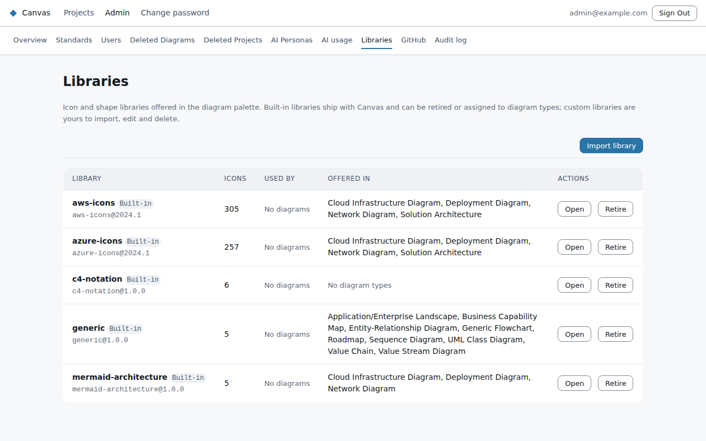

# Icon and shape libraries

Libraries are the icon sets people pick from in a diagram's palette: the Azure and AWS icons,
the C4 notation shapes, and any set of your own. The **Libraries** page (**Admin → Libraries**, or the
Libraries card on the Overview) lists them all and lets you add your own.

## Built-in and custom

Every library is marked **Built-in** or **Custom**.

- **Built-in** libraries ship with Canvas. You can't edit their name, licence or icons, and you can't
  delete them. You can **retire** them and choose which diagram types offer them.
- **Custom** libraries are the ones you import. You can rename them, edit or replace their icons,
  add more icons, retire them and, when no diagram uses them, delete them.

The list shows each library's icon count (with how many are retired), how many diagrams use its
icons, and the diagram types that offer it. **Open** shows the library's icons, each with a preview,
category, keywords and how many diagrams use it. Search narrows the grid; **Show retired** brings
retired icons back into view.

## Importing SVG files

1. Choose **Import library**, then **SVG files**.
2. Give the library a name (and a licence, if you want one recorded).
3. Choose one or more `.svg` files. Each file becomes one icon.
4. Check the previews. Each icon's name starts as its file name; you can change it, and add a
   category and keywords so people can find it by search.
5. Choose **Import**. The new library opens, and you can then choose where it's offered.

Canvas checks every file before anything is saved, so a problem shows in the preview. A file with a
problem is marked and is not imported; the rest still are. Canvas refuses:
- files over **200 KB**, which are almost always traced photos rather than icons;
- files that aren't a complete SVG, or have no usable size (they need a `viewBox`, or a `width` and
  `height` in pixels);
- files that declare XML entities;
- files with a `<style>` block, because its rules would restyle the whole exported diagram. Export
  the icon from your design tool with presentation attributes (or inline styles) instead.

Icons end up inside diagrams and exported files, so Canvas also **removes** anything that isn't
plain drawing: scripts, embedded images and other unknown elements, event handlers such as `onclick`,
and links to anything outside the file. Colours, gradients, masks and clipping stay. Internal ids
are renamed so two icons in one diagram can't clash.

### The 48 x 48 fit

Icons are drawn in a 48 x 48 space and scaled from there. Canvas fits your file's `viewBox` into that
box with a uniform scale, centred, never stretched. A wide logo ends up with space above and below it,
not squashed. Keep the artwork inside its `viewBox`, because anything outside is cut off.

## Importing a manifest

**Manifest (JSON)** is for sets that already exist in Canvas's own format, the same as the built-in
libraries: an `id`, a `version`, an optional `license`, and a list of `icons`, each with an `id`,
`displayName`, `category`, `keywords` and `assetRef` (the SVG artwork, already in the 48 x 48 space).
The dialog shows the id, version and icon count before you import. The artwork goes through the same
clean-up as an SVG upload. A manifest can't reuse the id of a built-in library, or a version of its
own id that already exists.

## Retiring and deleting

- **Retire** hides a library or icon from the palette's search so nobody places it in a new diagram.
  Diagrams that already use it keep drawing it and exporting it, so nothing breaks. **Restore**
  undoes it. This works for built-in and custom libraries.
- **Delete** removes it for good, and only for custom libraries and icons that **no diagram uses**.
  If a diagram does use it, Canvas refuses and lists those diagrams. Retire it instead, or change
  those diagrams first.

## Choosing where a library is offered

On a library's page, tick the diagram types whose palette should include it and choose **Save
palette**. Changing a built-in diagram type marks it as edited, so a Canvas update no longer resets
its palette to the default.

Every change on this page is recorded in the [audit log](audit-and-recovery.md).
