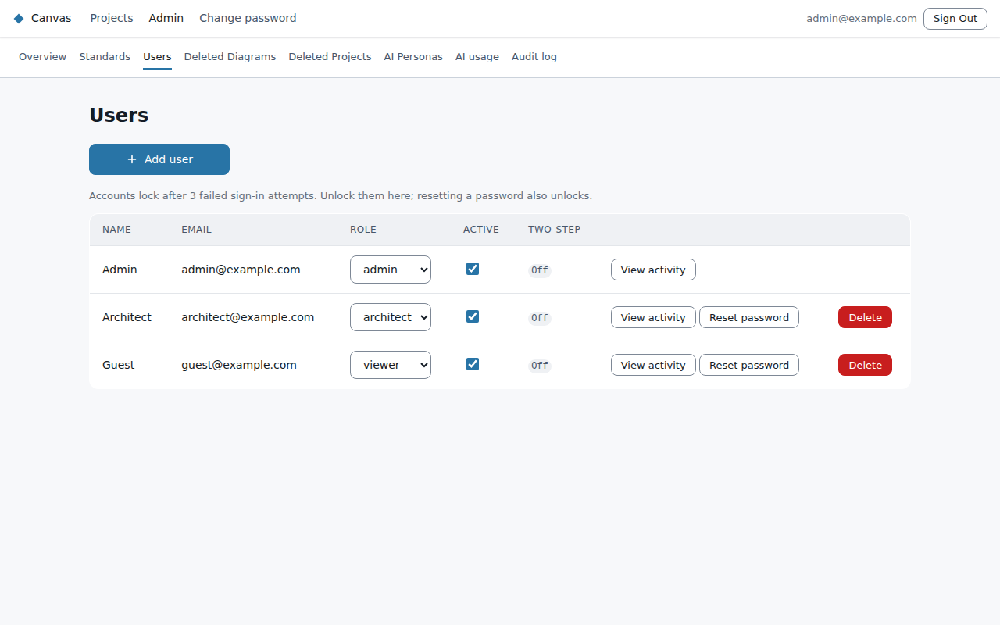
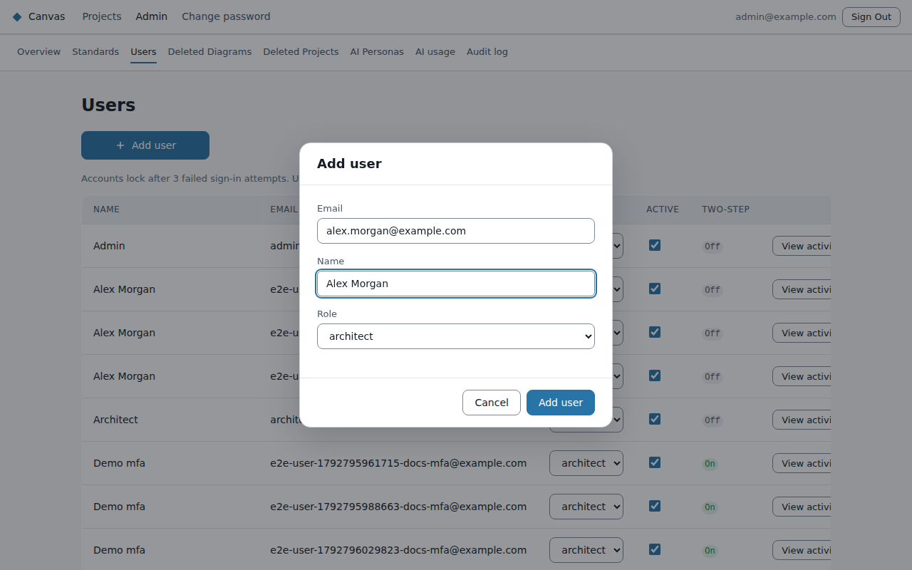
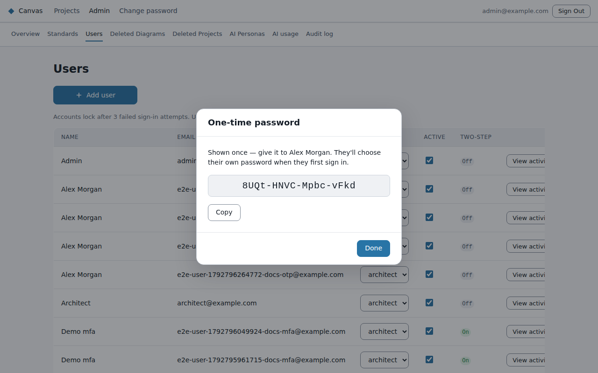
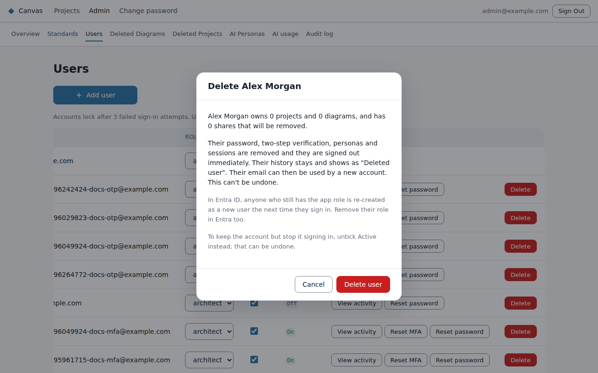

# Managing people

Everything here is on **Admin → Users**.

## Roles and personas

Each person has a **role**:
- **Viewer:** reads diagrams.
- **Architect:** creates and edits diagrams.
- **Admin:** everything, plus this console.

Change the role in the person's row.

People also have **personas** (Business, Enterprise, Solution, Technical), which decide which diagram
types they're offered. The Users page doesn't edit them yet.

With Entra sign-in, the role comes from the person's app role in Entra each time they sign in.
Change it there.

## Adding someone (Canvas accounts)

1. **Add user**, then enter their email, name and role.
2. Canvas shows a **one-time password once**. Copy it and give it to them securely. Canvas keeps
   only a scrambled copy, so it can't show it again.
3. At first sign-in they choose their own password and set up two-step verification (see the user
   guide's [Signing in](../user-guide/signing-in.md)).

## When someone is stuck

| Situation | What to do |
|---|---|
| Forgot their password | **Reset password**. A new one-time password is shown once, and they're signed out everywhere. A reset also unlocks the account. |
| **Locked** after three wrong passwords or codes | **Unlock**, or reset their password. Accounts never unlock by themselves. |
| Lost their phone, or used up their recovery codes | **Reset MFA**. They're signed out and set up two-step verification again at their next sign-in. |
| Can't sign in from a private window or Safari | Not an account problem: their browser blocks the sign-in cookie. They should use a normal window in Chrome, Edge or Firefox. |

**About lockout:** anyone who knows a person's email can lock their account with three wrong guesses.
That trade-off is accepted because Canvas is only reachable from approved networks. Unlocking takes
one click.

## Someone leaving

- **Deactivate** (untick **Active**): they're signed out immediately and can't sign in. Everything is
  kept, and you can reactivate them later.
- **Delete:** permanent. The dialog shows what they own.
  - **Their projects and diagrams** (including deleted ones) go to someone you choose.
  - **Removed:** their password, two-step verification, personas and the shares they received.
  - **History stays:** versions they wrote and shares they gave show **"Deleted user"**.
  - **Their email is freed** for a new account.
  - **Not possible** for yourself or the last active admin.
  - **With Entra sign-in,** also remove their app role in Entra, or they'll come back as a new user.

## If you're the only admin and you're locked out

Another admin can fix it from this page. If there's no other admin, whoever runs the Azure
environment can restore your access with `reset-admin.sh` (see [Operations](operations.md)).
