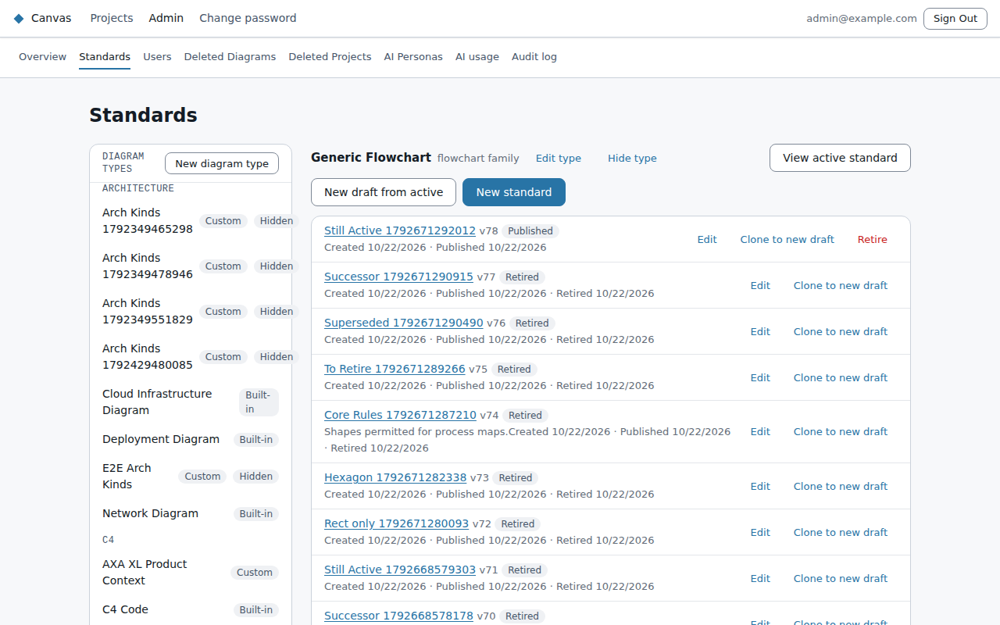
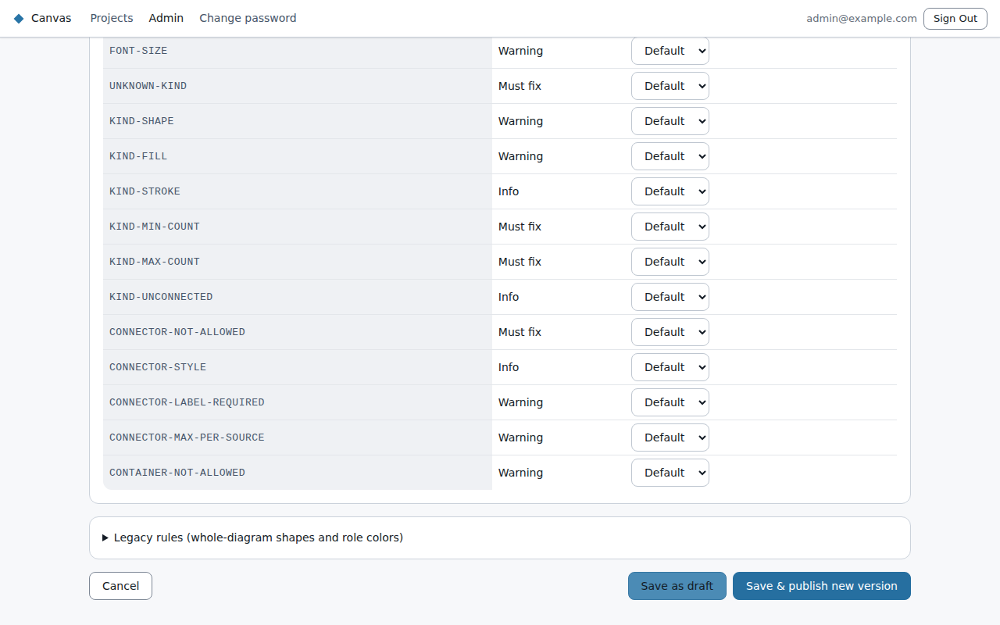

# Standards and diagram types

**Admin → Standards** holds the rules diagrams are checked against, one standard per diagram type,
and the diagram types themselves.

## What a standard says

A standard is a set of **element kinds**: the named things a diagram of that type is made of, such
as a value chain's *Primary Activity* or a C4 context's *Person* and *External System*. For each kind
you can set:
- **which shapes** it may use;
- **approved colours** (fill and outline swatches). People pick from these instead of any colour;
- **how many** a diagram must or may have (minimum and maximum);
- whether each one **must be connected** to something;
- for C4 types, **which C4 elements it applies to**: under *Applies to C4 elements*, the role
  (person, system, container or component) and whether it's the **External** (`_Ext`) variant. Give
  every kind a different combination: if two kinds match the same elements, the first one in the
  list claims them all;
- **connector rules**: which kinds may connect to which, and whether a connection needs a label.

Each rule has a **severity**: *Must fix*, *Warning* or *Info*. Standards never block anyone. They
shape what the editor and the AI offer, and flag the rest in the diagram's **Issues** tab.

## Lifecycle

- **Draft:** being written; not applied yet. Edit it freely.
- **Published:** the active standard for its diagram type. Every diagram of that type is checked
  against it.
- **Retired:** an earlier published version, kept for reference.

Any version can be opened read-only. **Edit** on a published or retired version starts a new
version from it. **Publish**, then **Save and publish** to confirm, makes the new version active,
retires the old one and re-checks the diagrams. Publishing is blocked while the standard itself has
errors.

Each built-in type comes with a **starter standard**. It describes the type rather than restricting
it, and is a good base for your own.

In the built-in C4 Context, Container and Component standards, every element kind is set to **Must
be connected**: an element with no relationships is flagged as a Warning. You can ignore it, and it
never blocks submitting a diagram for approval. Built-in standards are only added to a diagram type
that has none yet, so an installation set up before this change keeps its existing standard. To get
the warning there, edit that standard, tick **Must be connected** on each element kind, under
**Strictness** set `kind-unconnected` to Warning (its default is Info), and choose **Save & publish**.

## Diagram types

Also on this page:
- **Built-in types** (flowchart, C4, sequence, ERD and so on): you can change their name, description
  and which personas see them. You can't change their underlying diagram family.
- **New diagram type:** add your own type that uses an existing family, with its own name and
  standard. For example, a *Customer Journey* built on flowchart, with its own element kinds.
- **Hide type:** takes a type out of the New Diagram, Create with AI and Import choices. Existing
  diagrams of that type keep working. **Show type** brings it back.
