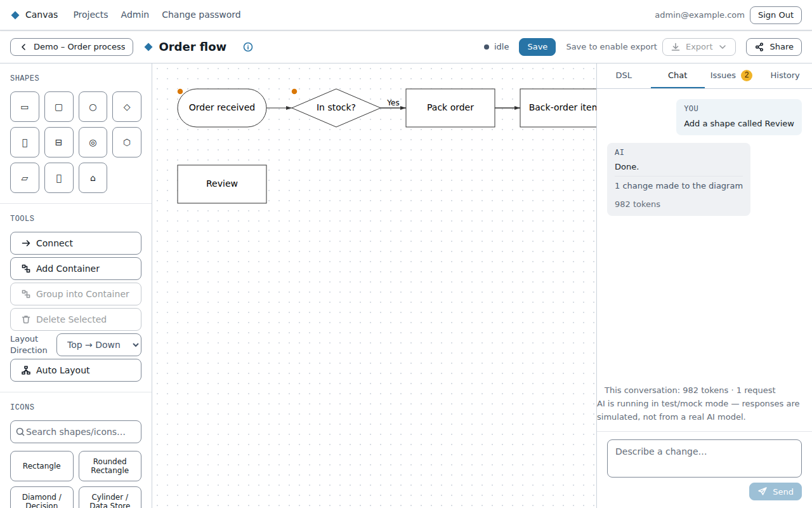

# AI chat

The **Chat** tab in the editor lets you change a diagram by describing the change, for example
"add a step called Review after Validate" or "make the payment service an external system".

- **Pick a persona** before your first message. Personas are AI assistants your admin has set up
  for kinds of work (business, enterprise, solution or technical architecture). The choice is fixed
  for that diagram's conversation.
- **The AI knows the diagram type and your standard.** It uses the right shapes and element
  kinds, and only the colours the standard allows. It also tries to fix any issues its own edits
  cause.
- **Under each reply**, a note says what changed: "2 changes made to the diagram". It also lists any
  change it couldn't make, and why.
- **The conversation is saved with the diagram.** Anyone who can edit the diagram sees it and can
  carry it on.
- **Token counts:** each reply may show how many tokens it used, and the panel shows a total for the
  conversation. Tokens are how AI use is measured (and paid for). Your admin can turn this display
  off.

Review what the AI did before saving. Its changes are ordinary edits: you can change or undo them
like any other, and nothing is kept until you **Save**.

If the Chat tab says AI chat is turned off, an admin has disabled it.
