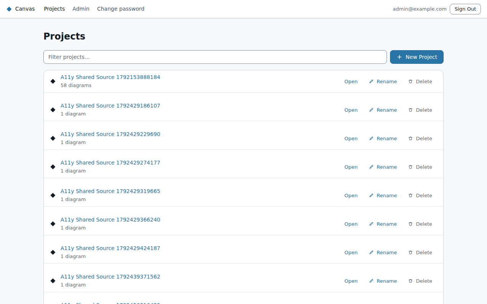
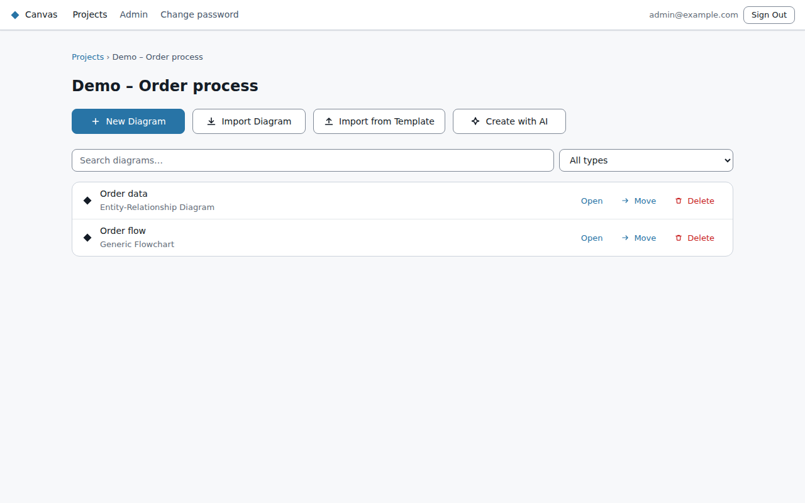

# Finding your way around

The bar at the top is the same on every screen:
- **Projects:** your list of projects.
- **Admin:** shown only to admins.
- **Change password:** only for Canvas accounts.
- **Help:** this guide, in the app. A **?** next to a feature opens its section in a new tab.
- **Sign Out.**

## Projects

Diagrams live in **projects**. Everyone who signs in can read every project and diagram; changing
them needs access from the owner. The list has two parts, each project with how many diagrams it
holds:
- **My projects:** projects you own or have been added to.
- **All projects:** everyone else's. You can open and read them, but not change them.

- **Recently opened:** above the lists, up to five diagrams you opened lately on this browser.
- **Find a project:** type in the filter box.
- **New project:** creates one, and you're its owner. (People with the viewer role can't create
  projects.)
- **Rename or delete:** owners and admins can rename a project. A project can only be deleted once
  it's empty.

Between the two, **Shared with me** lists diagrams other people have shared with you directly.

## A project's page

Click a project's name to open it. The page lists its diagrams.
- **Find a diagram:** search by name, or filter by diagram type.
- **Each diagram** has **Open**, **Move** (to another project) and **Delete**. Deleting moves it to
  the bin; an admin can restore it for 30 days.
- **New diagrams:** the buttons at the top create them (see [Creating diagrams](creating-diagrams.md)).

In a project you can only read, the page says so, and only **Open** is offered. Opening a diagram
there shows it read-only: no editing tools, no **Save** and no AI chat, and the top bar says
**Read-only** (or **Can comment**, if you've been given comment access).

The breadcrumb at the top (**Projects › Project name**) takes you back to the list.

## Links and the Back button

Every screen has its own web address, so you can bookmark a project or send someone a link to a
diagram. Your browser's **Back** and **Forward** buttons move between screens. If you try to leave a
diagram with unsaved changes, Canvas asks first.

When you come back to Canvas, it opens the project you were last in.
