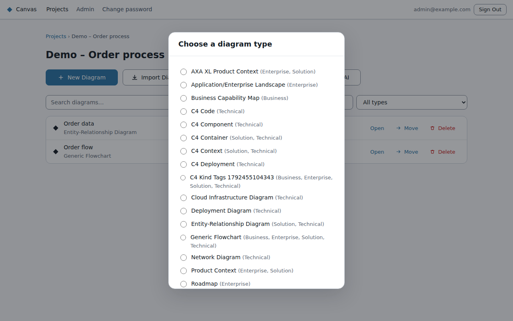
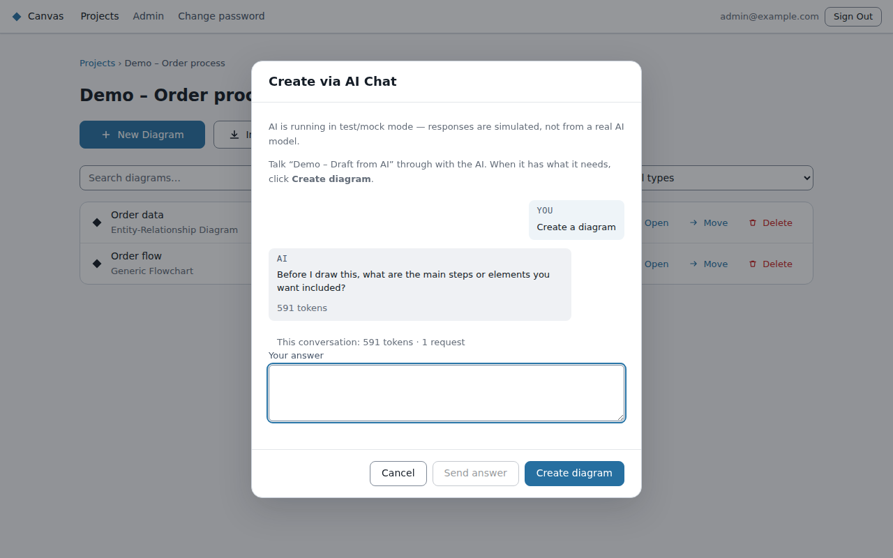

# Creating diagrams

Open a project and use one of the buttons at the top of its page.

## New Diagram

Pick a **diagram type** and Canvas opens an empty diagram in the editor. The type decides which
shapes, connectors and rules apply. Types include:
- **Flowchart:** Generic Flowchart, and the business types built on it: Business Capability Map,
  Value Chain, Value Stream, Application Landscape, Roadmap, Solution Architecture.
- **C4:** Context, Container, Component, Code, Deployment.
- **Others:** Sequence, Entity-Relationship (ERD), UML Class, and Network, Deployment and Cloud
  Infrastructure diagrams.

The list starts with the types for your personas (Business, Enterprise, Solution or Technical), which
your admin sets. Tick **Show all diagram types** to see the rest; Canvas remembers your choice on
this browser. If you have no personas, you see every type.

Your admin may hide some types, or add your organisation's own.

## Import Diagram

Paste [Mermaid](https://mermaid.js.org/) text, or upload a `.mmd` file. Canvas reads it into a
diagram you can then edit visually. If part of it can't be read, Canvas tells you which line.

## Import from Template

For some types (C4, sequence, ERD, UML class and the architecture types), you can **download a blank
template**: a simple text document with headings such as "People", "Systems" and
"Relationships". Fill it in, then upload it, and Canvas turns it into a diagram. It's a quick way to
capture a design without drawing it.

## Create with AI

Describe the diagram you want and the AI draws it.

1. Give the diagram a **name**, pick a **persona** (an AI assistant set up for a kind of
   architecture work) and a **diagram type**.
2. Describe what you want, in plain words.
3. If the description is vague, the AI may **ask a question** first. Answer it, or click
   **Create diagram** to have it draw with what it has.
4. When it has drawn something, the diagram opens in the editor. The conversation carries on in its
   **Chat** tab.
5. Nothing is saved for you: the diagram shows **Not saved**, and only you can see it. **Save** keeps
   it and adds it to the project. If you don't want it, leave and choose **Discard and leave**: the
   diagram is deleted, as if it had never been made. Reloading the page keeps the drawing; closing
   the tab without saving loses it.

**Cancel** before anything is drawn and nothing is kept. Token counts may appear under each reply
(see [AI chat](ai-chat.md)).
