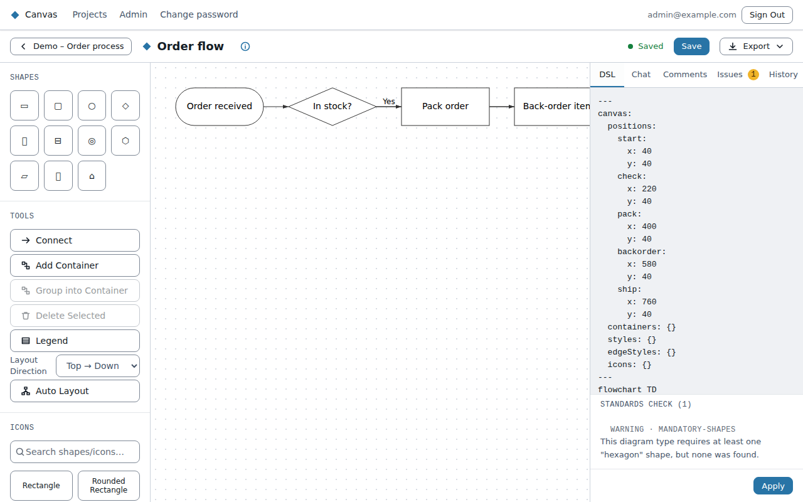
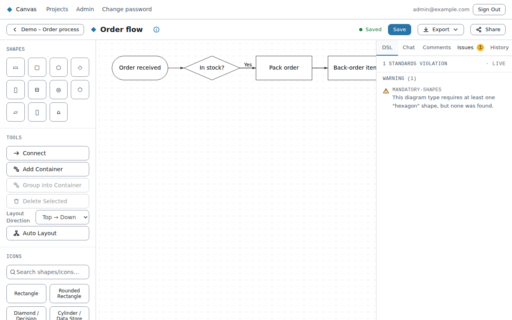
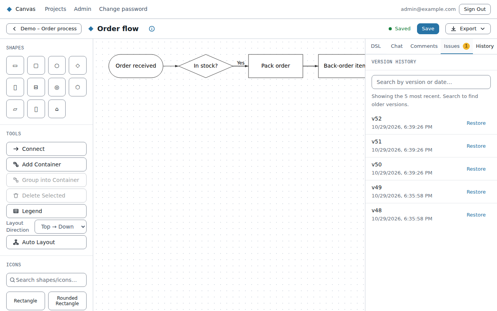

# The editor

Opening a diagram shows it on the **canvas** in the middle:
- **Left:** a rail of tools.
- **Right:** panels in tabs: **DSL**, **Chat**, **Issues**, **History**.
- **Top:** the diagram's name and the **Save**, **Share** and **Export** buttons.

**Save often.** The editor shows when you have unsaved changes. If you try to leave with unsaved
changes, it asks first.

## Drawing

- **Add a shape:** pick one under **Shapes** in the left rail. The shapes offered depend on the
  diagram type: a flowchart has rectangles, diamonds, circles and more; a C4 diagram has people,
  systems and containers; and so on.
- **Elements:** if your organisation has a **standard** for this diagram type, an **Elements** list
  offers its named element kinds (for example *Primary Activity* or *External System*), already
  shaped and coloured correctly. Use these when you can.
- **Move:** drag shapes. Shift- or Ctrl-click to select several, or drag a box around them.
- **Rename:** click the pencil next to a shape or connector and type.
- **Colour:** click the palette icon. If a standard applies, you choose from its approved colours.
- **Connect:** click **Connect**, then the first shape, then the second. While connecting you can
  choose the arrow direction (forward, reversed, both or none). Some types add more choices, such as
  cardinality for ERD and UML class diagrams.
- **Group:** **Add Container** draws a box (a subgraph, boundary or namespace, depending on the
  type). Select shapes and choose **Group into Container** to put them inside one.
- **Delete:** select something and press **Delete** or use **Delete Selected**. Canvas asks first.
- **Auto Layout** (flowcharts): arranges the shapes for you, top-down or left-to-right.

Sequence diagrams work differently: the layout follows the order of messages, so you don't drag.
The **Tools** section adds notes, loop/alt/opt blocks, activations and numbering.

## The DSL tab: the diagram as text

Every diagram is also Mermaid text. Edit either side and the other follows. Typing in the DSL tab
updates the canvas; drawing updates the text. If the text has an error, the tab shows the line.

## The Issues tab: standards

If a standard applies to the diagram type, the **Issues** tab lists where the diagram breaks it,
in three levels:
- **Must fix:** a rule the diagram has to meet.
- **Warning:** something to look at.
- **Info:** a suggestion.

Click an issue to select the shapes it's about. Issues never stop you saving. They show what to
fix.

## Comments

The **Comments** tab is where people talk about a diagram without changing it. Anyone who can view a
diagram can read its comments. To add one you need **Comment** or **Edit** access.

- **Add a comment:** type in the box at the bottom and click **Comment** (or press Ctrl+Enter, or
  Cmd+Enter on a Mac).
- **Pin it to a shape:** select one shape or connector on the canvas first, then tick **Pin to the
  selected shape**. A small speech bubble with a count appears on that shape. Click the bubble to
  jump to its comments. If the shape is later deleted, the comment stays and says it was on a shape
  that was removed.
- **Reply** to keep a conversation in one thread.
- **Resolve** a thread when it's dealt with. It disappears from the list and loses its bubble; tick
  **Show resolved** to see it, and **Reopen** to bring it back.
- **Edit or delete:** you can edit and delete your own comments. The diagram's owner and admins can
  delete anyone's. A deleted comment leaves "Comment deleted" so replies still make sense.

A number on the Comments tab shows how many comments are new since you last opened it. Canvas
doesn't send emails about comments. Comments are saved straight away, separately from the diagram,
so you don't need to click Save.

## The History tab: versions

Each save makes a **version**. The History tab lists the last five, with their dates, and you can
search them. **Restore** brings an earlier version back as the current diagram.

## Name and description

Click the diagram's name at the top to rename it. Its description, owner and creation date are
under **Diagram details**.
