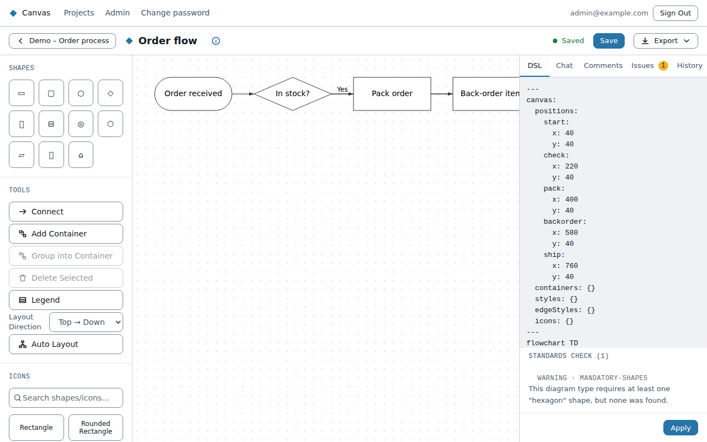
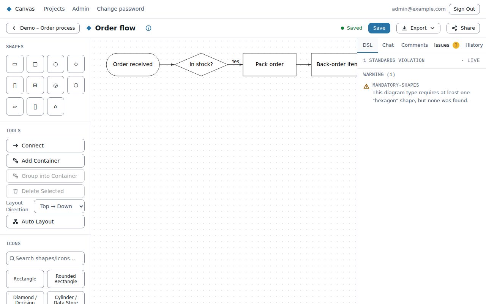
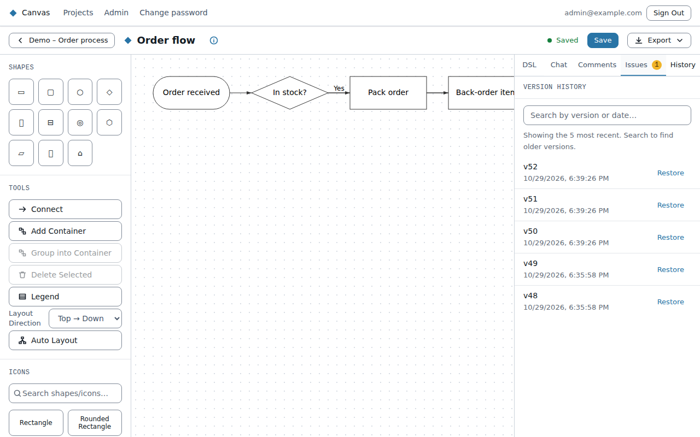
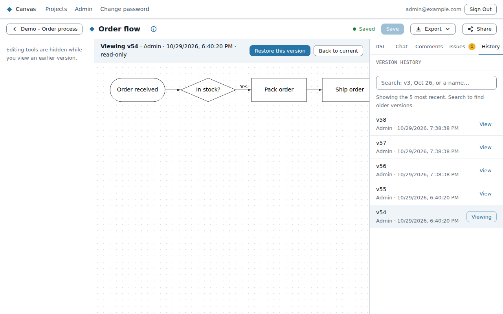

# The editor

Opening a diagram shows it on the **canvas** in the middle:
- **Left:** a rail of tools.
- **Right:** panels in tabs: **DSL**, **Chat**, **Issues**, **History**.
- **Top:** the diagram's name and the **Save** and **Export** buttons (and **Share**, if an admin has
  turned sharing on).

**Save often.** Next to **Save**, the editor shows **Unsaved changes**, **Saving…**, **Saved** or
**Couldn't save**. If you try to leave with unsaved changes, it asks first.

## When someone else is editing

Several people can work on the same diagram at once. Each sees the others' changes as they're made:
a shape someone adds, moves or renames shows up on your screen too, before anyone saves.

- **Who else is here.** A bar under the top lists who else has the diagram open, e.g. *Alex Smith is
  also editing this diagram with you (opened 10:31)*, and who is only watching (people who can view
  or comment but not edit). It also tells you if you have the diagram open in another tab.
- **What others have selected.** A shape, connector or group someone else has selected has an outline
  in their colour, with their name on a small tag. Each person keeps the same colour. (Not in sequence
  diagrams.)
- **Changes merge shape by shape.** If you move a shape while someone else renames it, both changes
  stay. If you both change the same thing at the same moment (both rename one shape), the later
  change wins.
- **One Save saves for everyone.** Everyone has the same diagram, so whoever clicks **Save** saves it
  for all: **Unsaved changes** turns to **Saved** on everyone's screen.
- **Leaving.** If you leave with unsaved changes while someone else is still editing, your changes
  aren't lost: they stay in the diagram for the others until someone saves. If you're the last one
  to leave, unsaved changes go, as usual, so Canvas asks first.
- **Typing in the DSL tab.** If the diagram changes while you're typing in the DSL tab, your text is
  kept, and the tab says the diagram has changed. **Load latest** replaces your text with the current
  diagram; **Apply** puts your text on the diagram, replacing those changes.
- **Restoring.** When someone restores an earlier version from **History**, everyone's screen
  switches to it, and a note says who restored it.

If the connection drops, a bar says *Reconnecting…*. You can keep working: your changes are kept and
shared when the connection is back. If live updates can't connect at all, Canvas works as it did
before live editing:

- **If they saved first.** When you save and someone has saved a newer version since you opened (or
  last saved) the diagram, your save is stopped and Canvas tells you who saved and when. Nothing of
  yours has been saved yet. Choose:
  - **Save mine anyway:** saves your version on top. Theirs stays in **History**.
  - **Load the newer version:** replaces what's on your screen with theirs. Use **Copy my version**
    or **Download my version (.mmd)** first if you want to keep yours, then paste it into the DSL
    tab later.
  - **Keep editing:** closes the message. Saving asks again.

Restoring an old version works the same way: if someone saved after you opened the diagram, the
restore is stopped and says who.

## Drawing

- **Add a shape:** pick one under **Shapes** in the left rail. The shapes offered depend on the
  diagram type: a flowchart has rectangles, diamonds, circles and more; a C4 diagram has people,
  systems and containers; and so on. Your organisation's **standard** for the type can narrow this,
  or offer only its own **Elements** (then the Shapes and Icons sections don't appear).
- **Architecture diagrams:** a **Services** section adds a Cloud, Database, Disk, Internet or Server
  service in one click; **Add Junction** adds a routing point. Search **Icons** for Azure and AWS
  services.
- **Elements:** if your organisation has a **standard** for this diagram type, an **Elements** list
  offers its named element kinds (for example *Primary Activity* or *External System*), already
  shaped and coloured correctly. Use these when you can.
- **Move:** drag shapes. Shift- or Ctrl-click to select several, or drag a box around them.
- **Rename:** click the pencil next to a shape or connector and type.
- **Colour:** click the palette icon. If a standard applies, you choose from its approved colours.
- **Connect:** click **Connect**, then the first shape, then the second. While connecting you can
  choose the arrow direction (forward, reversed, both or none). Some types add more choices, such as
  cardinality for ERD and UML class diagrams. In C4 diagrams a relationship can also start or end on a
  boundary, and in ER diagrams and flowcharts on a subgraph: click the group's box instead of a shape
  (state diagrams allow the same with a composite state).
- **Group:** **Add Container** draws a box (a subgraph, boundary or namespace, depending on the
  type). Select shapes and choose **Group into Container** to put them inside one.
- **Delete:** select something and press **Delete** or use **Delete Selected**. Canvas asks first.
- **Auto Layout:** arranges the whole diagram for you, inside groups and boundaries too, and resizes
  each group to fit. Pick a direction (top-down, left-to-right and so on) first; a group with its
  own direction keeps it. Architecture diagrams follow their own hints instead (which side each
  connector leaves from, and `align` lines), so they have no direction choice. In C4 diagrams it
  follows the side hints in the text: `Rel_D`/`Rel_U` put the target below or above,
  `Rel_R`/`Rel_L` to the right or left (side by side in a row, when the layout runs top-down), and
  `Lay_D`/`Lay_U`/`Lay_R`/`Lay_L` do the same without drawing a line. Hints that contradict each
  other can't all be met, so some are skipped. It's a normal edit: Save keeps it, and you can still
  move things afterwards. To keep something where it is, select shapes or a group and choose
  **Pin** (a small pin shows on each). Auto Layout then leaves pinned shapes where they are and
  arranges the rest around them; a pinned group keeps everything inside it. You can still drag
  pinned shapes, and **Unpin** lets Auto Layout move them again. With several pins far apart, a
  shape can end up on top of a pinned one.

Sequence diagrams work differently: the layout follows the order of messages, so you don't drag.
The **Tools** section adds notes, loop/alt/opt blocks, activations and numbering.

### State diagrams

A State diagram shows the states something can be in and how it moves between them. Instead of
**Shapes**, the left rail has a **State elements** section:

- **State:** a rounded box with a name. Rename it with the pencil.
- **Start** and **End:** the filled dot where the flow begins and the ringed dot where it finishes.
  Each draws without a label. There is one of each per diagram, and one per composite state, so the
  button switches off once it's there.
- **Choice:** a small diamond where the flow takes one of several routes.
- **Fork** and **Join:** a bar where one transition splits into parallel ones, and a bar where they
  come back together.
- **Composite state:** a state that contains other states. **Add Composite State** draws a box, and
  **Group as Composite** puts the selected states inside one. Select a composite state first and the
  State elements buttons add to it, with its own Start and End. A connector can start or end on the
  composite state's box: click **Connect**, then the composite state's title bar.
- **Notes:** written in the DSL tab (`note right of Idle : text`) and drawn beside the state.

Use **Connect** to draw transitions and double-click one to give it a label. **Auto Layout** works
here too. The DSL tab takes Mermaid `stateDiagram-v2` text, following Mermaid 12's state diagram
syntax.

### Wardley maps

A Wardley map shows the parts of a value chain: up the side, how **visible** each part is to the
user (their need at the top, what it depends on below); along the bottom, how **evolved** it is,
from Genesis through Custom Built and Product to Commodity. Where something sits is the map's
meaning, so there is no Auto Layout: you place everything yourself. Instead of **Shapes**, the left
rail has a **Map elements** section:

- **Component:** a dot with its name, something the user need depends on. **Anchor:** a user or
  user need, shown as bold text at the top of the chain.
- **Note**, **Annotation** (a numbered circle; with an `annotations [x, y]` line in the DSL tab
  their texts are listed in a box) and **Accelerator** / **Deaccelerator** (block arrows for what
  speeds up or holds back evolution).

A new element lands on a free spot: drag it where it belongs. The text records each element's
place as two numbers from 0 to 1, `[visibility, evolution]`, and dragging rewrites them (to two
decimals). Anything you don't move keeps the numbers it was written with.

Select an element and the rail shows where it is and lets you change it:

- **Name:** two components can't share a name (Mermaid would treat them as one).
- **Strategy:** Build, Buy, Outsource or Market, drawn as a ring around the dot.
- **Inertia:** a thick bar beside it, for something that resists change.
- **Evolves to:** a red dashed arrow to where it's heading on the evolution axis (0 to 1).
- **Add to pipeline:** a box under the component holding the forms it comes in (say, *Kettle*:
  electric, gas, campfire), each along the evolution axis at the parent's height. Drag one sideways
  to move it; drag the parent to move the whole pipeline. Deleting the parent deletes its pipeline.

Use **Connect** to draw a link (*depends on*) from one element to another. Select a link to give
it a flow arrowhead (forward, back or both), make it dotted, or label it. The map's size and its
evolution stage names are set in the DSL tab (`size [1100, 800]`,
`evolution Genesis -> Custom -> Product -> Commodity`), which takes Mermaid `wardley-beta` text.

## Linked diagrams

A shape or group can **open another diagram**. A common use is C4's levels: the Payments System in a Context
diagram opens the Payments Container diagram, whose API opens its Component diagram.

- **Make a link:** select one shape or group and choose **Link to diagram…** in the left rail. Find the diagram:
  - pick a project (this diagram's project comes first);
  - filter by type: the next level down is marked *suggested*, so a C4 Context diagram offers Container diagrams;
  - search by name.

  Or use **Create and link** to make a new, empty diagram for it in this diagram's project. Save to keep the link.
- **Follow a link:** a linked element shows a small blue link badge. Click it (or press Enter on it) to open the
  diagram. The links you followed show under the document bar, for example *Context › Payments containers*.
  Click one to go back, or use the browser's Back button.
- **Change or remove a link:** select the element and choose **Change link…** or **Remove link**, or use the
  **Links** tab.
- **The Links tab** lists every link in the diagram, where each one goes and whether it can be opened. **Used
  in** lists the diagrams that link to this one; it counts saved diagrams only.
- **A link that can't be opened** shows an orange **!** badge and a count on the Links tab. There are three cases:
  - the diagram is someone else's unsaved draft;
  - it's in the bin (restoring it mends the link);
  - it no longer exists (remove the link or point it somewhere else).

Anyone who can read a diagram can follow its links. Every signed-in person can read every saved diagram, so a
link never shows anyone something they couldn't open anyway. A sequence diagram's links go on participants only.

In an SVG export a linked element opens its diagram in Canvas, and a flowchart's or state diagram's Mermaid
export has a `click` line for it (see [Exporting](sharing-and-exporting.md#exporting)). A diagram submitted to
GitHub lists its linked diagrams in its README.

## Zoom

The controls at the bottom-left of the canvas zoom the drawing from 25% to 400%: **−** and **+**
step out and in, the percentage goes back to 100%, and **Fit** shows the whole diagram. You can
also hold **Ctrl** (**Cmd** on a Mac) and scroll, or pinch on a trackpad, to zoom towards the
pointer; **Ctrl +**, **Ctrl −** and **Ctrl 0** work while the canvas has focus. Zoom only changes
your view: it isn't saved with the diagram and doesn't count as a change. Exports are always full
size.

## Legend

A **legend** is a small key on the canvas that explains what each shape, colour and line means.
Click **Legend** in the **Tools** section of the left rail to show or hide it. Turning it off keeps
your settings, so turning it back on restores the same legend. Sequence diagrams don't have one.

- **Standard entries:** if your organisation has a standard for this diagram type, the legend lists
  each element kind (for example *Primary Activity*) and each connector from the standard that the
  diagram actually uses, with a sample shape or line. They update as you draw.
- **Edit legend:** click **Edit legend** (or double-click the legend) to set a title, untick
  **Show** to hide a standard entry, type a new label to rename it (clear the label to go back to
  the standard's), and **Add entry** for your own. Your own entries are a shape (shape, fill and
  stroke colour) or a line (solid, dotted or thick, and arrow style) with a label.
- **Move:** drag the legend box. Until you move it, it sits to the right of the diagram.
  The **Delete** key never removes it.
- **Remove:** to get rid of a legend altogether, click **Edit legend**, then **Remove legend**. This
  deletes its title, renamed and hidden entries and your own entries; if you've changed any of
  them, Canvas asks first. To keep them for later, hide the legend with the **Legend** button instead.
- **Exports and saving:** the legend is saved with the diagram and appears in SVG and PNG exports
  (and in anything that uses them). The Mermaid export leaves it out, because Mermaid has no legend
  syntax. The legend lives in the diagram's front-matter on the DSL tab.

## The DSL tab: the diagram as text

Every diagram is also Mermaid text. Edit either side and the other follows. Typing in the DSL tab
updates the canvas; drawing updates the text. If the text has an error, the tab shows the line.

The DSL tab reads Mermaid's newer sequence-diagram syntax: half arrows (such as `-|\`), central
connections (`A->>()B`) and participant `link` menus (http and https links only; they're kept and
exported, but Canvas doesn't show them as a menu). Participant types, such as
`participant DB@{ "type": "database" }`, are drawn as the nearest Canvas shape: a database as a cylinder, a
queue as a pill, and a boundary, control or entity as a circle. The type is kept and exported. Numbering can
start anywhere and step by decimals (`autonumber 10`, `autonumber 1.5 0.25`). Class diagrams read
`class A["Display label"]`. In ER diagrams an attribute's type or name can hold spaces when it is
written between backtick characters (the name first name, for example), and a type ending in `?`
marks an optional value (`string? middleName`). ER diagrams also read subgraphs (`subgraph Sales` …
`end`, nested if you like, with an optional title in square brackets and their own `direction`): each
becomes a group on the canvas, and a relationship can start or end on one.

Flowcharts read Mermaid's newer shape syntax, `A@{ shape: cyl, label: "Orders" }`, with any of
Mermaid's shape names. Shapes Canvas has no drawing of (such as `doc`, `cloud` or `flag`), and icon
and image nodes (`icon:`, `img:`), are drawn as the nearest Canvas shape; the Mermaid name is kept,
so the exported text still has it. Image addresses must be http or https links. Edge ids
(`A e1@--> B`) and edge options such as `e1@{ animate: true }` are kept and exported; Canvas doesn't
animate or curve edges. Subgraph options such as `one@{ view: collapsed }` (written after the
subgraph's `end`) are kept and exported too; Canvas always shows the subgraph open.

Longer links (`A ---> B`, `A -..-> B`, `A ===> B`) are read too. In Mermaid the extra length spaces
the shapes further apart; Canvas keeps it and exports it, but draws them like any other connector.

## The Issues tab: standards

If a standard applies to the diagram type, the **Issues** tab lists where the diagram breaks it,
in three levels:
- **Must fix:** a rule the diagram has to meet.
- **Warning:** something to look at.
- **Info:** a suggestion.

Click an issue to select the shapes it's about. Issues never stop you saving. They show what to
fix.

## Comments

The **Comments** tab is where people talk about a diagram without changing it. Anyone who can view a
diagram can read its comments. To add one you need **Comment** or **Edit** access.

- **Add a comment:** type in the box at the bottom and click **Comment** (or press Ctrl+Enter, or
  Cmd+Enter on a Mac).
- **Pin it to a shape:** select one shape, connector or group (a box around other shapes, such as a
  subgraph or boundary) on the canvas, then tick **Pin to** followed by its name. Until exactly one is
  selected, the option is off and the panel says what to select. A small speech bubble with a count
  appears on that element. Click the bubble to jump to its comments. If the element is later
  deleted, the comment stays and says it was on a shape (or connector, or group) that was removed.
- **Reply** to keep a conversation in one thread.
- **Resolve** a thread when it's dealt with. It disappears from the list and loses its bubble; tick
  **Show resolved** to see it, and **Reopen** to bring it back.
- **Edit or delete:** you can edit and delete your own comments. The diagram's owner and admins can
  delete anyone's. A deleted comment leaves "Comment deleted" so replies still make sense.

A number on the Comments tab shows how many comments are new since you last opened it. Canvas
doesn't send emails about comments. Comments are saved straight away, separately from the diagram,
so you don't need to click Save.

## The History tab: versions

Each save makes a **version**. The History tab lists the last five, with who saved each one and
when. To find an older one, search by:
- **version number:** `v3`, `#3` or just `3`;
- **date:** as the list shows it, or `Oct 26`, `10/26`, `2026-10-26`, `today`, `yesterday`;
- **name:** the person who saved it, e.g. `jane`.

Click **View** on a version to see it on the canvas, read-only. A bar at the top says which version
you're looking at, the DSL tab shows its text, and the editing tools are hidden. Your current
diagram, including anything you haven't saved, is untouched. **Back to current** returns to it.

To bring the version back, click **Restore this version** and confirm. Restoring never deletes
anything: it saves that version's content as a new version, marked **Restored from v3** in the
list, so the diagram you had stays in the history too. If you have unsaved changes, Canvas asks
whether to save them first (they become a version of their own) or to discard them. You need edit
access to restore; anyone who can open the diagram can view its versions.

## Name and description

Click the diagram's name at the top to rename it. Its description, owner and creation date are
under **Diagram details** (the ⓘ button beside the name). Choose **Close** or press Escape to
leave it; a description you haven't saved yet is still there when you reopen it.
