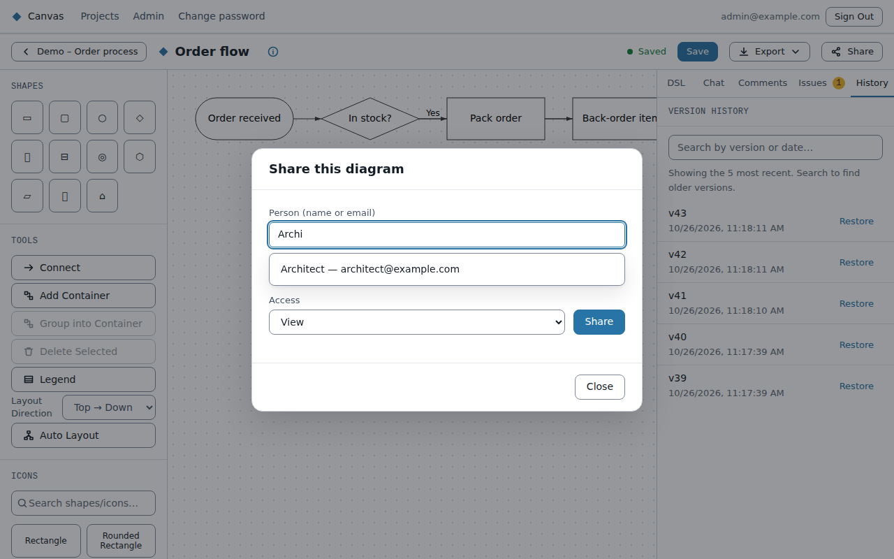
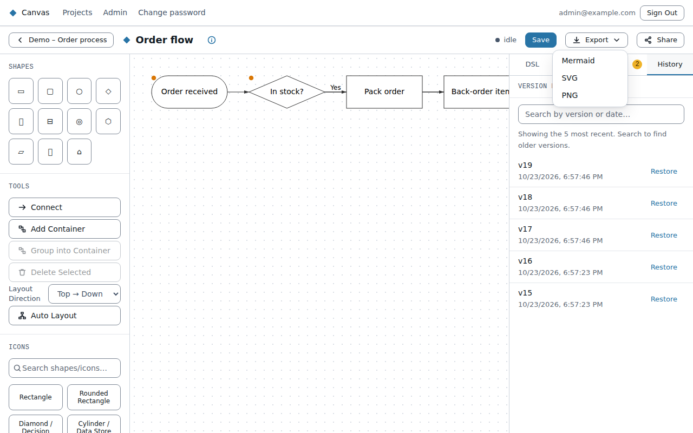

# Sharing and exporting

Everyone who signs in can read every project and diagram. Sharing gives people **more** than that:
the right to comment, change things, or manage who else can.

## Project members

Most sharing happens on a project: its members see all its diagrams at their level. Click
**Members** on a project's page to see who owns the project and who has been added.

The owner, members with **Manage**, and admins can:
- **add someone:** type their name or email, pick them, choose **Comment**, **Edit** or **Manage**,
  and click **Add**;
- **change someone's level** with the list next to their name;
- **remove someone**;
- **Make owner** (owner and admins only): hands the project to that member. You stay on as a
  member with Manage. To hand it to someone who isn't a member yet, add them first.

Everyone else sees the list but can't change it. Each change is recorded in the admin audit log.

## Copying a link

**Copy link** (in the editor, and on a project's page) copies the address of that diagram or
project. Anyone who signs in can open it; it doesn't give them any extra access.

## Sharing a single diagram

To give someone more access to just one diagram, rather than the whole project, use **Share** in
the editor. The **Share** button only appears once an admin has turned sharing on (it's off by default). With
it off, diagrams already shared with you still appear under **Shared with me**.

Click **Share** in the editor and start typing a colleague's name or email address. A list of
matching people appears: use the Up and Down arrow keys and Enter (or click) to pick one, and
press Escape to close the list. Then choose their access and click **Share**:

| Level | They can |
|---|---|
| **View** | Open and read the diagram (everyone signed in can already do this) |
| **Comment** | Read the diagram and add comments (see [Comments](editor.md#comments)) |
| **Edit** | Change it (and use its AI chat) |

Projects have a fourth level, **Manage**: Edit, plus deciding who else has access. A project's
owner always has Manage, and only the owner or someone with Manage can give or remove it.

Someone's access is the highest level they get from anywhere: the project, a share of the
diagram itself, or owning it. People with the **viewer** role never get more than Comment,
whatever they're given.

People who already have access are shown in the list as "has view access" (or comment/edit)
and can't be picked again; to change someone's level, revoke their access and share again. You
appear as "(you)". The list below the form shows each person who has access, with their name and email.

If the person you want isn't listed, type their full email address and press **Share** without
picking: Canvas looks up that exact address. They must already have a Canvas account (with
single sign-on, that means they have signed in at least once). The diagram then appears under **Shared with me** on their
project list. Access to a project covers all its diagrams; sharing a diagram is for giving someone
more access to that one diagram without the whole project.

You need **edit** access to share a diagram or remove someone's access; the **Share** button only
appears for people who have it. Anyone can see who has access.

## Exporting

**Export** in the editor downloads the diagram as:
- **Mermaid** (`.mmd`): the text, to use in other tools or documentation that renders Mermaid.
- **SVG**: a sharp, scalable picture for documents and wikis.
- **PNG**: an image.

Export always uses the **saved** diagram, so save first. The buttons are disabled while you have
unsaved changes.
