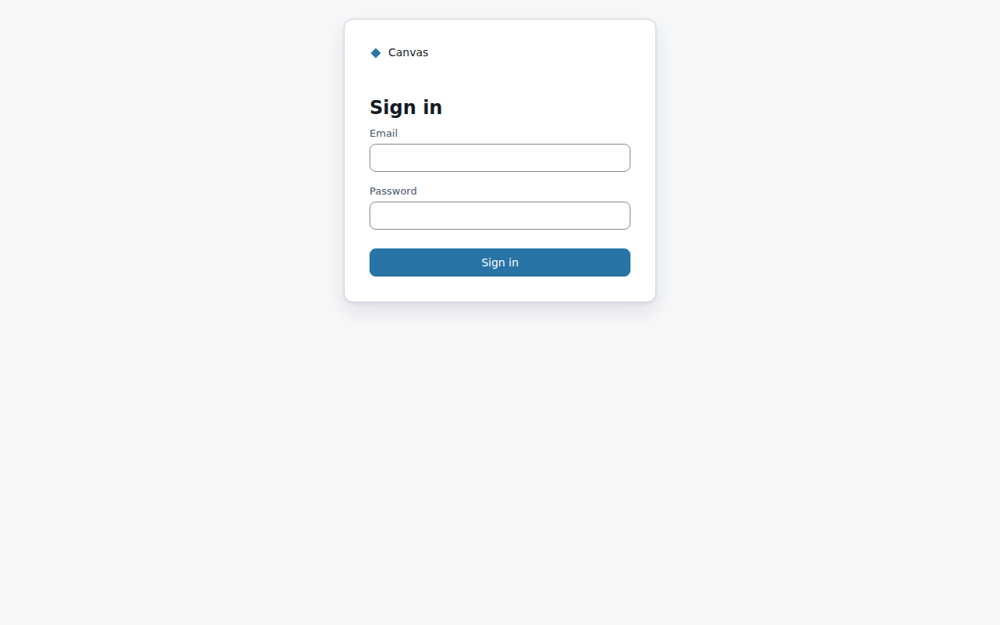
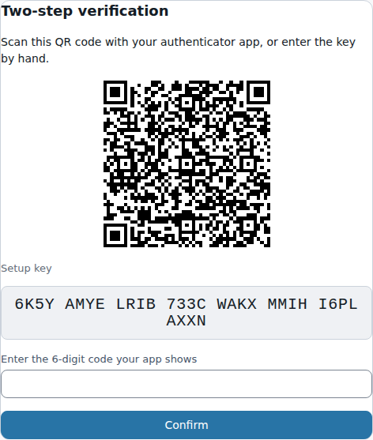
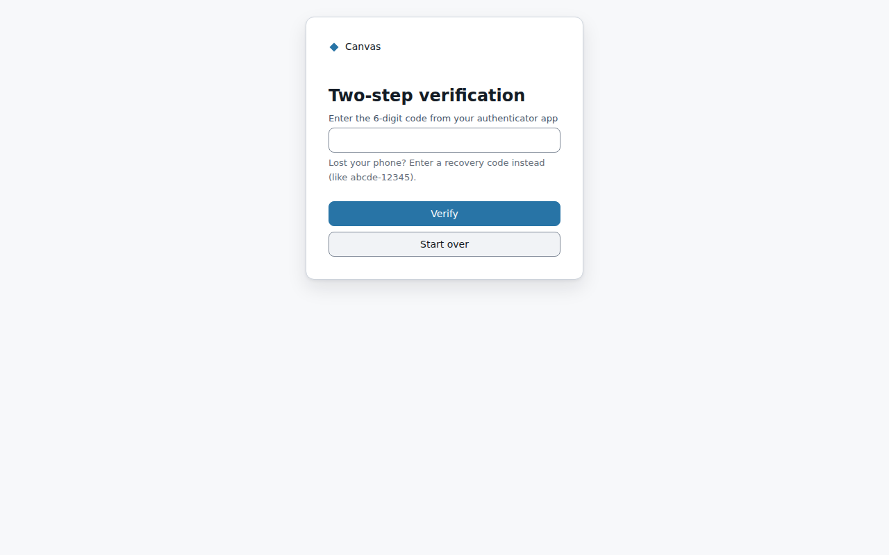

# Signing in

How you sign in depends on how your organisation set Canvas up. The sign-in page shows one or both
of these:
- **Sign in with Microsoft:** your organisation's Microsoft account (Entra ID). Your organisation's own
  rules apply, including any two-step verification it requires.
- **Email and password:** an account an admin created for you in Canvas. Canvas also asks for a code
  from an authenticator app (two-step verification).

## The first time (Canvas accounts)

An admin creates your account and gives you a **one-time password**.

1. Sign in with your email and the one-time password.
2. **Choose your own password.** It must be at least 12 characters, not a common password, and must
   not contain your email name. Until you do this, nothing else works.
3. **Set up two-step verification.** Open an authenticator app on your phone, such as Microsoft
   Authenticator, Google Authenticator or 1Password, and scan the QR code. If you can't scan it,
   type the setup key shown under the code. Then enter the 6-digit code the app shows.
4. **Save your 10 recovery codes** somewhere safe, such as a password manager. Each one works once,
   in place of a code from your phone. Tick "I've saved these" to finish.

## Every time after that

Enter your email and password, then the 6-digit code from your authenticator app. A code works once.
If one is refused, wait for the next code.

**No phone?** Enter one of your recovery codes instead, in the same box. Canvas tells you how many
you have left. When they run out, ask an admin to reset your two-step verification.

## If something goes wrong

| What you see | What to do |
|---|---|
| "Invalid email or password" | Check both and try again. **Three wrong tries in a row lock the account.** |
| "This account is locked…" | Ask an admin to unlock it (or to reset your password). It doesn't unlock by itself. |
| "This account has been deactivated…" | Your account was switched off. Ask an admin. |
| "Your browser blocked Canvas's sign-in cookie" | This happens in **private/incognito windows** and in **Safari** (including every browser on an iPhone or iPad). Use a normal window in Chrome, Edge or Firefox, or allow third-party cookies for the Canvas site. |
| "Too many sign-in attempts from this network" | Wait a minute and try again. |
| Lost your phone and your recovery codes | Ask an admin to **reset your two-step verification**. You set it up again at your next sign-in. |
| The site doesn't load at all | Canvas may only be reachable from your organisation's networks, or it may be paused. Ask your admin. |

## Signing out

Use **Sign Out** at the top right. It signs you out of this browser. If you used Microsoft sign-in,
it signs you out of Microsoft too.
