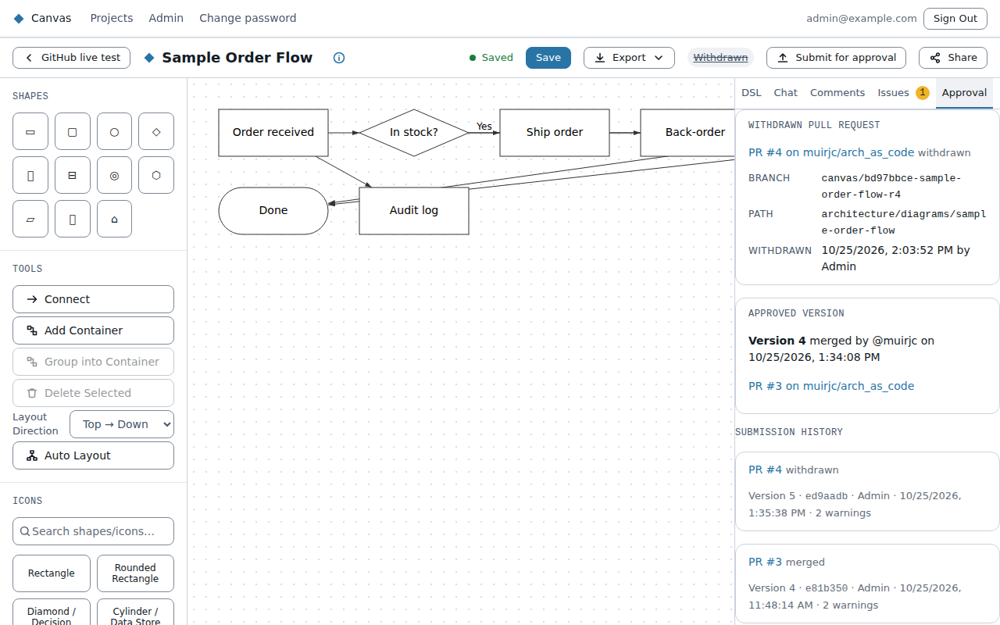

# Submitting a diagram for approval

If your admin has linked a project to a GitHub repository, its diagrams can be sent there for
approval. Each submission opens a **pull request**, where reviewers comment and approve. Merging the
pull request approves the diagram, and closing it without merging rejects it.

You'll only see **Submit for approval** in the editor when the diagram's project is linked.

## Submitting

1. **Save** your changes first. Canvas submits the saved version, so the button is disabled while
   there are unsaved changes.
2. Choose **Submit for approval**. The dialog shows the repository and folder the diagram goes to,
   and how many standard warnings will be listed in the pull request.
3. Confirm. Canvas opens the pull request and links to it.

You need **edit** access to the diagram to submit it.

**Must fix issues block submitting.** If the diagram breaks a rule that its standard marks as Must
fix, fix it first. The **Issues** tab lists the problems. Warnings and info don't block, but they are
listed in the pull request so reviewers can see them.

## What reviewers see on GitHub

The pull request's README shows the diagram as a picture, exactly as it looks in Canvas. Below it,
under **Mermaid source**, GitHub draws the diagram again from its Mermaid text. That second view
looks different:
- **Positions:** GitHub always arranges a Mermaid diagram itself, so shapes won't sit where you put
  them. Mermaid has no way to say where a shape goes.
- **Colours:** kept for shapes in flowcharts, C4, ER and class diagrams, and for lines in flowcharts
  and C4. Sequence and architecture diagrams show GitHub's default colours, and so do lines in ER
  and class diagrams (Mermaid has no colour syntax for these). In C4, when several lines join the
  same two elements in different colours, those lines show the default colour.
- **Icons:** GitHub uses its own icon set, not Canvas's.

The picture at the top is the one to review.

## Changing a diagram under review

You can keep editing while the pull request is open. The status next to the button changes to
**Changes since submitting**. When you're ready, choose **Push update to PR #n**. Canvas adds your
saved changes to the same pull request, so reviewers see what changed. If nothing has changed since
the last submission, Canvas tells you it's already up to date.

## Following the review

The status next to the button keeps up with GitHub while the pull request is open. Canvas checks
about once a minute while the diagram is open, and every 15 minutes otherwise.

| Status | Meaning |
|---|---|
| Not submitted | The diagram has never been submitted |
| In review · PR #n | The pull request is open. Failing checks, requested changes or an approval show here too |
| Changes since submitting | You've saved changes that aren't in the pull request yet |
| Approved (version N) | The pull request was merged, so version N is approved |
| Rejected | The pull request was closed without merging |
| Withdrawn | Someone withdrew the submission from Canvas |

The **Approval** tab in the editor's side panel has the details:
- The open pull request, with its reviewers' decisions and the repository's checks. Each one links
  to GitHub.
- **Refresh**, to ask GitHub right away.
- The approved version: who merged it and when. If someone changed the files on GitHub before
  merging, Canvas says so, because the approved files then differ from what Canvas submitted.
- Every pull request the diagram has had, and each update pushed to it.

A project's diagram list shows the same status next to each submitted diagram.

## Withdrawing

To take a submission back, open the **Approval** tab and choose **Withdraw**. Canvas closes the
pull request with a comment saying who withdrew it. You need edit access. Submitting again later
opens a new pull request.

Once a diagram is approved, rejected or withdrawn, submitting it again opens a new pull request.

Edit diagrams in Canvas, not in GitHub. Changes made in the repository aren't copied back.
