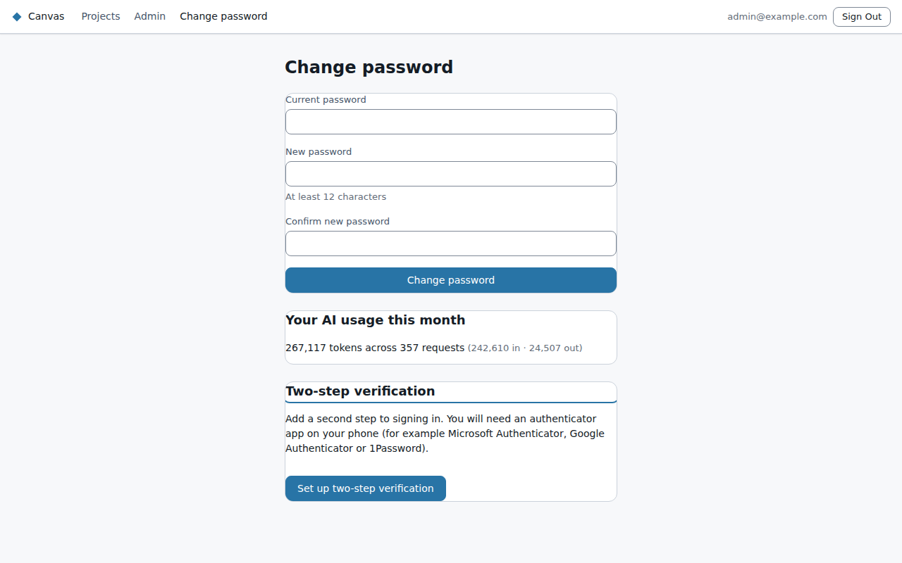

# Your account

For Canvas accounts, **Change password** at the top of the screen opens your account page.

- **Change password:** enter your current password and the new one twice. The rules are the same as
  at first sign-in: at least 12 characters, not a common password, and no email name. Changing it
  signs you out on your other devices.
- **Two-step verification:** if it isn't required for your account, you can turn it on here. Once
  it's on, only an admin can reset it.
- **Your AI usage this month:** how many tokens your AI chat has used this month (shown unless your
  admin turned token counts off).

If you sign in with Microsoft, your password and two-step verification are managed by your
organisation's Microsoft account, not by Canvas.
